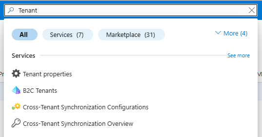
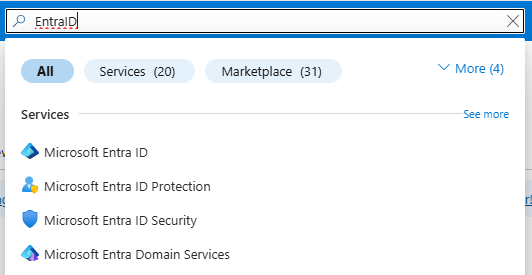

# LAB 1 - Introduction
Ce premier TP vise à prendre en main le portail Azure et se familiariser avec le format des exercices.

Connectez-vous sur [portal.azure.com](https://portal.azure.com) avec l'identifiant et le *Temporary Access Pass* qui vous ont été remis.

Un TAP est un code temporaire qui **remplace** la MFA : c'est lui-même une méthode d'authentification forte, valable un temps limité. Il peut être à usage unique ou non, peut être configuré pour durer au maximum 30 jours, et est généralement utilisé pour des besoins de support informatique (récupération de compte, onboarding, etc.).

### Récupérer le TenantID
L'ID (indicateur) de votre Tenant est une information simple mais importante pour bien comprendre le fonctionnement d'EntraID.

Pour un attaquant, il peut permettre de cibler une entreprise en recherchant des identifiants et secrets en source ouverte (GitHub Dorks, Google Dorks).

Pour une blue team, le TenantID va permettre de mieux discerner les sources et cibles des actions faites sur votre entreprise.

#### Depuis le portail
Une fois authentifié sur le portail [portal.azure.com](https://portal.azure.com) :
1. Utilisez la barre de recherche (raccourci *G+/*) ;
2. .

ou
1. Recherchez le service EntraID ;
2.  ;

<details>
<summary>TenantID</summary>

```Bash
3d8cc2d6-b3a5-4ad6-89f6-070d04df936f
```
</details>

Profitez-en pour changer la langue du portail en anglais si vous le souhaitez.

#### Ligne de commande
Pour faire fonctionner ses services, Microsoft va exposer des URLs dont vous n'avez pas le contrôle. Ces URLs seront utilisées par d'autres services, par vos utilisateurs, mais aussi par le biais d'autres protocoles (authentification, fédération, etc.).
```Bash
curl -s https://login.microsoftonline.com/jazz-pot.com/.well-known/openid-configuration
```
+ Testez avec votre entreprise

### Navigation
#### EntraID

Depuis le portail [portal.azure.com](https://portal.azure.com) :
1. Utilisez la barre de recherche et recherchez-y "EntraID" ;
2. Utilisez la barre latérale pour naviguer parmi les objets Entra.

<details>
<summary>Combien y a-t-il d'utilisateurs ?</summary>

37
</details>

<details>
<summary>Combien y a-t-il de groupes ? Combien sont des groupes de sécurité ?</summary>

+ 12 au total ;
+ 4 groupes de sécurité.
</details>

<details>
<summary>Combien y a-t-il d'applications d'entreprise ?</summary>

8
</details>

<details>
<summary>Dans quels groupes êtes-vous, quels sont vos droits, une application vous est-elle affectée ?</summary>

+ Groupes : Incident Responders et Stagiaire ;
+ Droits : Security Reader ;
+ Application : AWS IAM Identity Center. Nous y reviendrons au LAB 5.
</details>

### Bonus
#### Informations d'authentification

Il existe un moyen de trouver des informations sur les moyens d'authentification d'une entreprise sans être authentifié au préalable. Essayez d'en trouver pour l'entreprise jazz-pot.com !

Un indice : plus facile sur Mozilla.