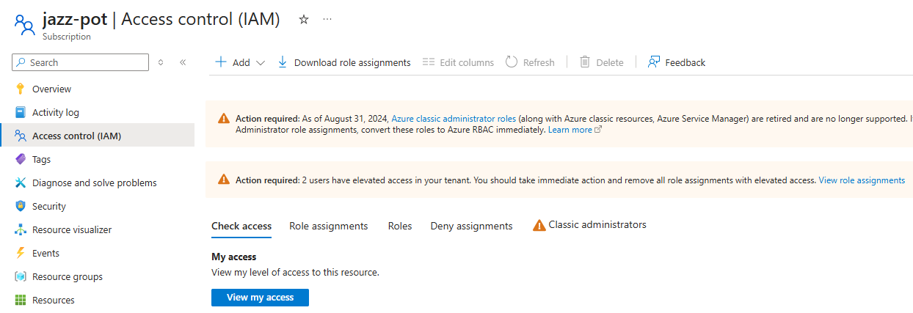
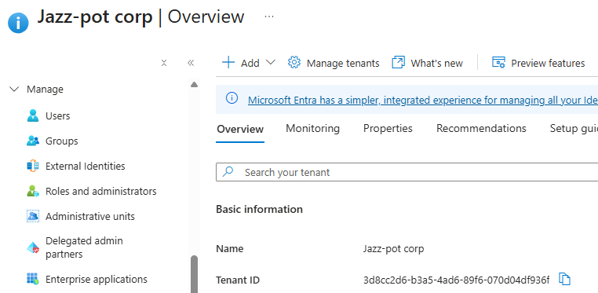
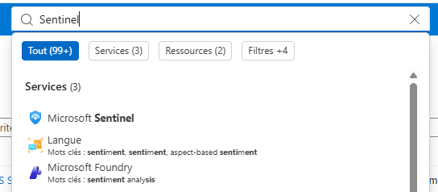
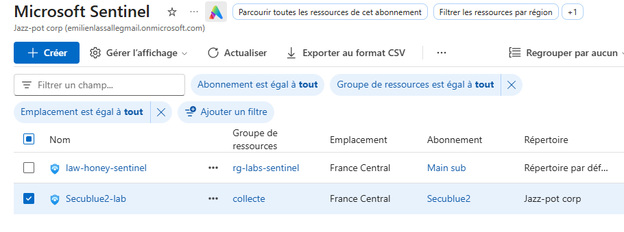
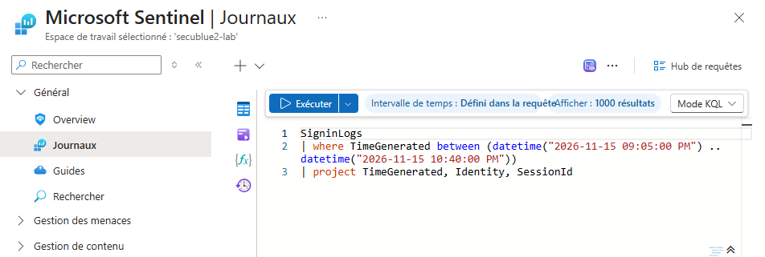
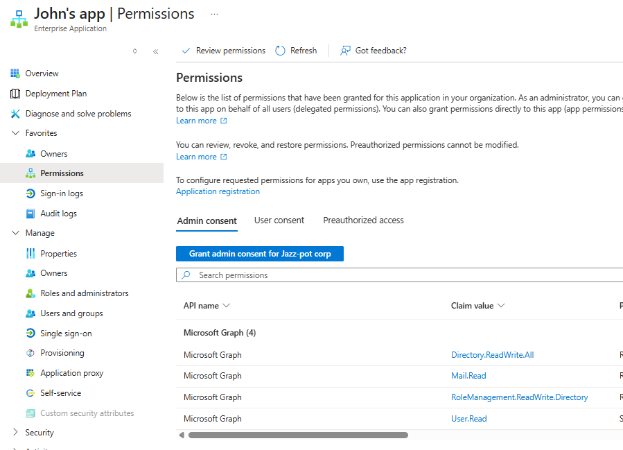
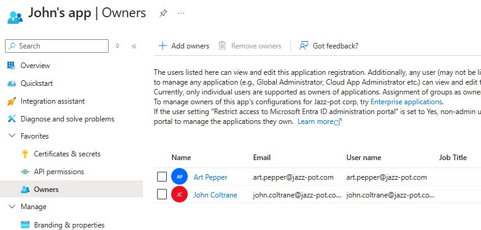
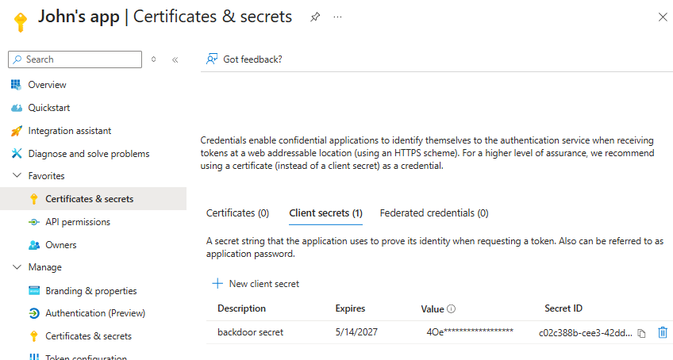

# LAB 2 - Élévation de privilèges et persistance
L'admin *admin.jazz-pot@jazz-pot.com* a remarqué quelque chose d'inhabituel en effectuant ses tâches d'administration :

Il vous mandate pour investiguer.

> Toutes les heures de ce lab sont en **UTC** (heure de Paris = UTC+1).

### Compte suspect
Un des avertissements mis en évidence par le screenshot de l'admin est assez parlant. Un seul type de compte à privilège permet de s'octroyer ce type de rôle sur une subscription, lequel ?
<details>
<summary>Réponse</summary>

Un **Global Admin** peut s'octroyer le rôle *User Access Administrator* sur l'ensemble des subscriptions du Tenant.
</details>


Allez vous-même vérifier sur le portail Azure et sur le service EntraID :



Un compte possédant ce rôle est-il suspect ? Retenez son ObjectID.
<details>
<summary>Réponse</summary>

Le compte **BackdoorMan@jazz-pot.com** a été créé récemment et ne respecte pas la nomenclature *prenom.nom*. Son ObjectID est :
```bash
c690b85e-ea3d-4795-b52a-8403f358e2a5
```
</details>

Il faut investiguer sur ce compte.

### Investigations
Les manipulations d'objets EntraID tels que les utilisateurs ou les applications sont tracées dans les **AuditLogs**.

Vous pouvez investiguer directement depuis le portail dans l'onglet **Audit logs** du service EntraID. Cependant, l'interface n'est pas très confortable.

Utilisez la barre de recherche pour ouvrir **Microsoft Sentinel** :



Sélectionnez l'instance **secublue2-lab** :


Cliquez à gauche sur **Logs** et profitez-en pour vérifier que la syntaxe est bien configurée en mode KQL (en haut à droite) :


Commençons avec la KQL suivante :
```KQL
AuditLogs
| where TimeGenerated between (datetime("2026-11-15 09:20:00 PM") .. datetime("2026-11-15 09:32:00 PM"))
| where Identity != "Microsoft Teams Services"
//L'auteur d'une action peut etre un utilisateur (InitiatedBy.user) ou une application (InitiatedBy.app)
| extend SourceIP = InitiatedBy.user.ipAddress, UserPrincipalName = InitiatedBy.user.userPrincipalName, InitiatingUserId = InitiatedBy.user.id
| extend AppName = InitiatedBy.app.displayName, ServicePrincipalId = InitiatedBy.app.servicePrincipalId
| project TimeGenerated, Category, Identity, SourceIP, OperationName, ResultDescription, TargetResources, AdditionalDetails, CorrelationId, UserPrincipalName, InitiatingUserId, AppName, ServicePrincipalId
| sort by TimeGenerated desc
```

Arrivez-vous à retrouver l'affectation du rôle Global Administrator et la création du compte ?
<details>
<summary>Réponse</summary>

```KQL
AuditLogs
| where TimeGenerated between (datetime("2026-11-15 09:29:00 PM") .. datetime("2026-11-15 09:32:00 PM"))
| where Identity != "Microsoft Teams Services"
| extend SourceIP = InitiatedBy.user.ipAddress, UserPrincipalName = InitiatedBy.user.userPrincipalName, InitiatingUserId = InitiatedBy.user.id
| extend AppName = InitiatedBy.app.displayName, ServicePrincipalId = InitiatedBy.app.servicePrincipalId
| where OperationName in ("Add user","Add member to role") and TargetResources contains "c690b85e-ea3d-4795-b52a-8403f358e2a5"
| project TimeGenerated, Category, Identity, SourceIP, OperationName, ResultDescription, TargetResources, AdditionalDetails, CorrelationId, UserPrincipalName, InitiatingUserId, AppName, ServicePrincipalId
| sort by TimeGenerated desc
```

+ 21:30:35 : **Add user** (BackdoorMan@jazz-pot.com)
+ 21:30:40 : **Add member to role** → *Global Administrator*
+ La ligne **Add member to role outside of PIM (permanent)** de 21:31:30 le confirme : le rôle est attribué de manière **permanente**, sans passer par PIM.
</details>

Qui est à l'origine de ces actions ?

<details>
<summary>Réponse</summary>

Ce n'est pas un utilisateur mais une application : les colonnes *UserPrincipalName* et *SourceIP* sont vides, *AppName* indique **John's app**. L'ObjectID de son service principal (colonne *ServicePrincipalId*) :
```bash
b0b9ec14-2783-49ad-9506-00167c4ce492
```
</details>

Quel user-agent l'application a-t-elle utilisé ?

<details>
<summary>Réponse</summary>

```bash
curl/8.18.0
```
Il apparaît dans la colonne *AdditionalDetails* des lignes **Add user** et **Add member to role**.
</details>

Parmi les droits de cette application, lesquels ont permis de telles actions ? (Vérifiez cette information directement depuis le portail en cherchant le *ServicePrincipalId*)

<details>
<summary>Réponse</summary>


+ Directory.ReadWrite.All
+ RoleManagement.ReadWrite.Directory
+ Mail.Read n'a pas été utilisé ici, en revanche l'attaquant avait la capacité de lire les emails de tous les collaborateurs.
</details>

Il faut investiguer les sign-ins de cette application pour déterminer la nature de ce comportement. Nous pouvons investiguer ici en filtrant sur l'AppId ou l'ObjectID.

```KQL
AADServicePrincipalSignInLogs
| where TimeGenerated between (datetime("2026-11-15 09:20:00 PM") .. datetime("2026-11-15 09:35:00 PM"))
| where AppId == "11eab211-76f5-46f3-898c-89ebad96358a"
//TimeGenerated est l'heure d'ingestion du log, CreatedDateTime l'heure réelle de l'authentification
| project TimeGenerated, CreatedDateTime, ServicePrincipalName, ResultSignature, ClientCredentialType, ServicePrincipalCredentialKeyId, ResourceDisplayName, IPAddress, AutonomousSystemNumber, Location, AppOwnerTenantId, SessionId, UserAgent
| sort by TimeGenerated desc
```

<details>
<summary>Est-ce une application interne ?</summary>

Oui, le champ **AppOwnerTenantId** pointe sur le TenantID remonté au LAB 1. Qui plus est, nous avons pu consulter ses permissions dans notre propre portail.
</details>

<details>
<summary>Quel est son type d'authentification ?</summary>

Le champ **ClientCredentialType** = *clientSecret* couplé à **ServicePrincipalCredentialKeyId** (*c02c388b-cee3-42dd-bb39-2d71a7ded2b5*) indique qu'il s'agit d'une authentification *client/secret*.
</details>

<details>
<summary>Vers quelle ressource l'application s'est-elle authentifiée ?</summary>

Le champ **ResourceDisplayName** indique que l'application s'est authentifiée à la *Graph API*.
</details>

<details>
<summary>Que pouvez-vous dire des indicateurs de source du sign-in ?</summary>

Les champs **IPAddress** : *2a02:4780:83:7f6e::1* et **AutonomousSystemNumber** : 47583 indiquent un **VPS (hébergeur Hostinger) en France**. La géolocalisation française ne suffit pas à rassurer : c'est le *type* d'IP (hébergeur, pas un FAI ni le réseau de l'entreprise) qui est suspect.
</details>

Il est possible de pivoter dans les logs de l'API Graph pour déterminer si d'autres actions ont été effectuées :
```KQL
MicrosoftGraphActivityLogs
| where TimeGenerated between (datetime("2026-11-15 09:29:00 PM") .. datetime("2026-11-15 09:32:00 PM"))
| where AppId == "11eab211-76f5-46f3-898c-89ebad96358a"
| project TimeGenerated, IPAddress, RequestMethod, ResponseStatusCode, RequestUri, ResponseSizeBytes, ClientAuthMethod, UserAgent, Roles
| sort by TimeGenerated desc
```

Avec quel outil l'attaquant a-t-il piloté l'application ? Que remarquez-vous dans la séquence des requêtes ?

<details>
<summary>Réponse</summary>

+ **UserAgent** = *curl/8.18.0*
+ La séquence est un script de privesc en 3 temps :
  1. `GET roleDefinitions?$filter=templateId eq '62e90394-…'` → recherche du rôle *Global Administrator*
  2. `POST /users` (**201**) → création de BackdoorMan
  3. `POST /roleManagement/directory/roleAssignments` → **404** puis **201** 5 secondes plus tard : le compte venait d'être créé et n'était pas encore répliqué, l'attaquant a relancé.
+ La colonne **Roles** confirme les permissions vues dans le portail : `Directory.ReadWrite.All Mail.Read RoleManagement.ReadWrite.Directory`.
</details>

Nous avons récupéré le **ServicePrincipalCredentialKeyId** précédemment, vérifions s'il a été ajouté récemment :

```KQL
AuditLogs
| where TimeGenerated between (datetime("2026-11-15 09:20:00 PM") .. datetime("2026-11-15 09:32:00 PM"))
| extend SourceIP = InitiatedBy.user.ipAddress, UserPrincipalName = InitiatedBy.user.userPrincipalName, InitiatingUserId = InitiatedBy.user.id
| extend UserAgent = AdditionalDetails[0].value, AppName = TargetResources[0].displayName
| extend OldValue = TargetResources[0].modifiedProperties[0].oldValue, NewValue = TargetResources[0].modifiedProperties[0].newValue
| project TimeGenerated, Category, UserPrincipalName, SourceIP, OperationName, AppName, OldValue, NewValue, UserAgent
| sort by TimeGenerated desc
```

Qui a créé ce secret, et depuis où ?

<details>
<summary>Réponse</summary>

+ Le secret a été ajouté à **21:26:53**, soit moins de 4 minutes avant son utilisation (*CreatedDateTime* du sign-in : 21:30:34).
+ Il a été créé par **john.coltrane@jazz-pot.com**, depuis l'IP **162.0.238.73** (géolocalisée à Los Angeles).

Comparez les champs **OldValue** et **NewValue** : *NewValue* décrit le secret nouvellement créé et mentionne notamment le **ServicePrincipalCredentialKeyId** remonté dans les *AADServicePrincipalSignInLogs*. *OldValue* vaut `[]` : avant cette opération, l'application n'avait **aucun** secret.
</details>

<details>
<summary>Pourquoi John était-il en mesure de créer un secret ?</summary>

Comme le nom de l'application le laissait deviner, John en était *Owner* :

</details>

Nous pouvons également vérifier depuis le portail, en sélectionnant l'enregistrement de l'application :


Ce n'est pas une fuite de secret : un secret a été **forgé** sur l'application par le compte de John. Soit John est malveillant, soit son compte est compromis.

###### BONUS
Trouvez des cas d'usages de détection pour ces comportements.
