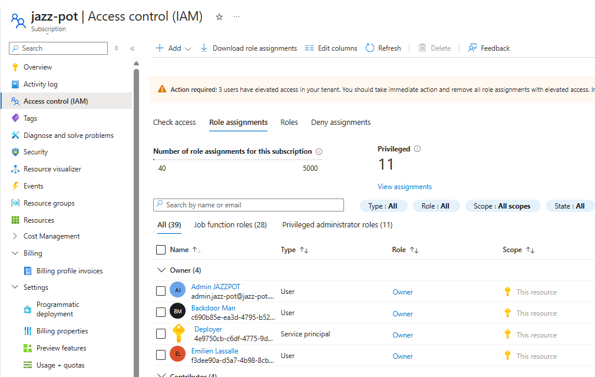
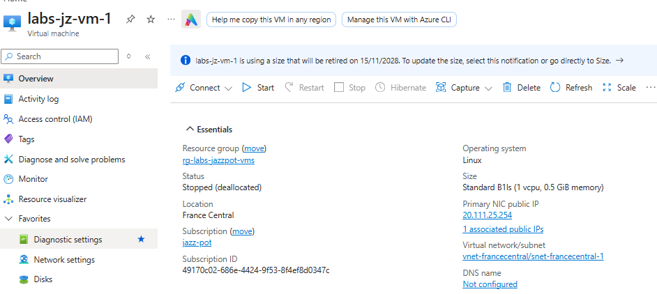

# LAB 4 - Compromission de ressources
Revenons au point de départ du LAB 2 : le screenshot de l'admin signalait qu'un compte s'était octroyé un accès élevé sur les subscriptions Azure. Le LAB 2 a montré comment **BackdoorMan** a été créé, le LAB 3 comment l'attaquant y est parvenu. Reste à savoir ce qu'il a fait de ce compte sur la subscription **jazz-pot**, qui héberge des ressources critiques.

L'attaquant ne semble pas motivé par la compromission d'EntraID en elle-même : EntraID n'est qu'un moyen d'atteindre les ressources.

> Toutes les heures de ce lab sont en **UTC** (heure de Paris = UTC+1).

### Élévation d'accès
Le rôle *User Access Administrator* est un rôle Azure (RBAC) qui permet d'attribuer n'importe quel rôle sur le périmètre où il est affecté. Un **Global Admin** peut se l'attribuer en un clic (*Access management for Azure resources*). Le périmètre est alors la **racine** (`/`) : tous les management groups et toutes les subscriptions du tenant.

Confirmez que c'est bien notre utilisateur fraîchement créé qui a élevé ses privilèges :
```KQL
AuditLogs
| where TimeGenerated between (datetime("2026-11-15 09:30:00 PM") .. datetime("2026-11-15 09:40:00 PM"))
| extend SourceIP = InitiatedBy.user.ipAddress, UserPrincipalName = InitiatedBy.user.userPrincipalName, InitiatingUserId = InitiatedBy.user.id
| where UserPrincipalName == "BackdoorMan@jazz-pot.com"
| project TimeGenerated, Category, UserPrincipalName, SourceIP, OperationName, ResultDescription, InitiatingUserId
| sort by TimeGenerated desc
```

Qui, quand, depuis où ?
<details>
<summary>Réponse</summary>

+ 21:34:37 : **BackdoorMan@jazz-pot.com** s'élève en *User Access Administrator*.
+ Depuis **162.0.238.73**.
+ *InitiatingUserId* = `c690b85e-ea3d-4795-b52a-8403f358e2a5`, l'ObjectID de BackdoorMan retenu au LAB 2.

4 minutes après sa création (21:30:35) et 1 minute après l'enregistrement de son propre Authenticator (21:33, BONUS du LAB 3).
</details>

### Attribution d'un rôle
Le rôle *User Access Administrator* seul ne suffit pas : il faut ensuite l'utiliser pour s'octroyer des droits sur les ressources. Les actions sur les ressources Azure sont tracées dans l'**Activity Log** :
```KQL
AzureActivity
| where TimeGenerated between (datetime("2026-11-15 09:30:00 PM") .. datetime("2026-11-15 09:50:00 PM"))
| where Caller == "BackdoorMan@jazz-pot.com"
| extend requestBody = Properties_d.requestbody
| project TimeGenerated, CallerIpAddress, Caller, OperationNameValue, ActivityStatusValue, ActivitySubstatusValue, requestBody
| sort by TimeGenerated desc
```

Quel rôle s'est-il attribué, et sur quel périmètre ? (Vous pouvez vous aider de Google)
<details>
<summary>Réponse</summary>

+ 21:36:41 : le **RoleDefinitionId** *8e3af657-a8ff-443c-a75c-2fe8c4bcb635* correspond au rôle **Owner** d'Azure RBAC.
+ Le **Scope** */subscriptions/49170c02-686e-4424-9f53-8f4ef8d0347c* correspond à la subscription **jazz-pot**.
+ Le **PrincipalId** est celui de BackdoorMan : il se l'attribue à lui-même.

Le champ **Condition** limite cet Owner : il ne peut pas attribuer à son tour les rôles *Owner*, *User Access Administrator* ou *Role Based Access Control Administrator*. C'est la condition proposée par défaut par le portail. Elle n'empêche en rien de **tout faire** sur les ressources.
</details>

Allez vous-même vérifier sur le portail Azure : recherchez **Subscriptions**, sélectionnez **jazz-pot**, puis **Access control (IAM)** → onglet **Role assignments** :


<details>
<summary>L'attribution est-elle toujours active ? Que signale le bandeau en haut de la page ?</summary>

+ Oui : **Backdoor Man** apparaît toujours comme **Owner** de la subscription (*This resource*), attribué directement à l'utilisateur (pas via un groupe).
+ Le bandeau *Action required: 3 users have elevated access in your tenant* est l'avertissement vu par l'admin au LAB 2 : l'élévation en *User Access Administrator* à la racine est, elle aussi, toujours active.
</details>

### Actions sur les ressources
Il faut maintenant savoir ce qu'il a fait de ses nouveaux privilèges :
```KQL
AzureActivity
| where TimeGenerated between (datetime("2026-11-15 09:30:00 PM") .. datetime("2026-11-15 09:50:00 PM"))
| where Caller == "BackdoorMan@jazz-pot.com"
| extend Resource = tostring(split(_ResourceId, "/")[-1]), statusMessage = Properties_d.statusMessage
| project TimeGenerated, CallerIpAddress, Caller, OperationNameValue, ActivityStatusValue, Resource, statusMessage, _ResourceId
| sort by TimeGenerated desc
```

A-t-il créé des ressources ? En a-t-il modifié ?
<details>
<summary>Réponse</summary>

+ 21:39 : il a tenté de créer une VM **BIGCRYPTOVM** (*MICROSOFT.RESOURCES/DEPLOYMENTS/VALIDATE/ACTION*) : **échec**, `RequestDisallowedByPolicy`. La policy *LABs - Allowed VM SKUs (allow-list)* interdit les grosses tailles de VM. Le nom laisse peu de doute sur l'usage prévu : du **cryptominage**.
+ 21:41-21:42 : il a exécuté des commandes sur les 3 VMs **labs-jz-vm-1**, **labs-jz-vm-2** et **labs-jz-vm-3** (*MICROSOFT.COMPUTE/VIRTUALMACHINES/RUNCOMMAND/ACTION*).
+ 21:43 : il a déployé l'extension **enablevmaccess** sur **labs-jz-vm-1** (*EXTENSIONS/WRITE*). Cette extension sert à **réinitialiser le mot de passe** ou la clé SSH d'un compte de la VM.

Pièges de lecture :
+ Chaque action apparaît plusieurs fois (*Start*, *Accept*, *Success* ou *Failure*) : c'est une seule opération.
+ *PLACEMENTRECOMMENDATIONS* et *BACKUPVALIDATEFEATURES* (21:38-21:39) ne sont pas des actions de l'attaquant : c'est l'**assistant de création de VM du portail** qui les déclenche pendant qu'il remplit le formulaire.
</details>

<details>
<summary>Peut-on savoir quelles commandes ont été exécutées sur les VMs ?</summary>

Non : l'Activity Log trace les opérations du **plan de contrôle** Azure (qui, quoi, sur quelle ressource), pas le contenu du script. Il faudrait des logs **dans** la VM (agent de collecte, syslog).
</details>

### Exfiltration
Vous souhaitez regarder de plus près les VMs. Est-ce qu'il y en a une qui sort du lot par sa configuration ?

<details>
<summary>Réponse</summary>

Oui, la VM labs-jz-vm-1 possède une IP publique, elle est sûrement exposée sur Internet...

</details>

Vous questionnez l'admin qui vous indique que la machine est particulièrement sensible et qu'elle est exposée en SSH sur Internet. Il n'y a pas de logs système dessus, mais il avait activé les **VNet Flow Logs** il y a longtemps pour résoudre un souci réseau :
```KQL
NTANetAnalytics
| where TimeGenerated between (datetime("2026-11-15 09:40:00 PM") .. datetime("2026-11-15 11:50:00 PM"))
| extend SrcIp = tostring(split(SrcPublicIps, "|")[0]) //SrcPublicIps contient aussi des compteurs : on ne garde que l'IP
| summarize Flux = count(), MB_VM_vers_Internet = round(sum(BytesDestToSrc) / 1048576.0, 1), MB_Internet_vers_VM = round(sum(BytesSrcToDest) / 1048576.0, 1), Debut = min(FlowStartTime), Fin = max(FlowEndTime) by SrcIp, DestIp, DestVm
| sort by Debut desc
```
*Les VNet Flow Logs sont agrégés avec un délai : la fenêtre de recherche est volontairement plus large.*

Trouvez-vous des indicateurs suspects ?
<details>
<summary>Réponse</summary>

+ Environ **5 Go** (5 138 Mo) sont sortis de labs-jz-vm-1 (*172.16.0.6*) entre 21:43 et 21:45 : une **exfiltration**.
+ Le port 22 indique que cet accès a été fait via **SSH** (probablement `scp`), juste après le reset du mot de passe par *enablevmaccess*.
+ *109.160.32.167* échange un trafic faible et symétrique (environ 1 Mo dans chaque sens) en continu depuis **avant** l'attaque (21:29) : ce n'est pas lié à l'incident, mais c'est à faire qualifier par l'admin.
+ Les autres IPs ne font que quelques Ko : ce sont des **scanners et bots de brute-force** d'Internet.
</details>

###### BONUS
Trouvez des cas d'usages de détection pour ces comportements.
