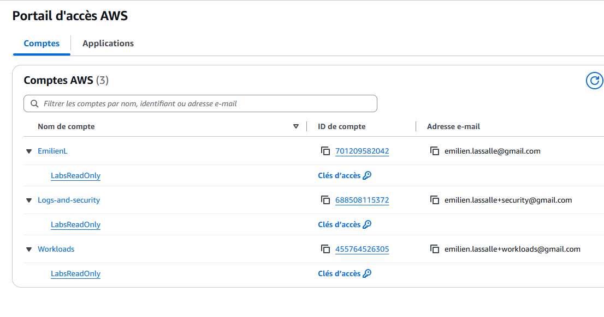
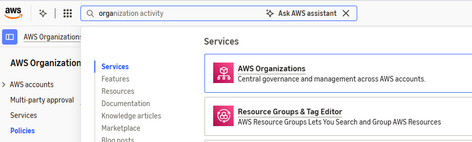
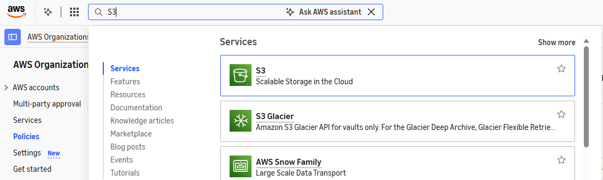

# LAB 5 - Prise en main d'AWS
Jazz-pot corp héberge une partie de ses workloads sur AWS. Avant d'investiguer dessus, il faut savoir **comment l'environnement est organisé** : quels comptes existent, à quoi ils servent, où sont les ressources et où sont les logs.

### Fédération avec EntraID
Les identités AWS ne sont pas gérées dans AWS : elles restent dans EntraID et sont fédérées vers AWS (SAML pour l'authentification, SCIM pour synchroniser utilisateurs et groupes) via *AWS IAM Identity Center*.

Retrouvez l'application d'entreprise qui porte cette fédération dans EntraID (**Enterprise applications**). Quels groupes y sont affectés ?

<details>
<summary>Réponse</summary>

L'application **AWS IAM Identity Center (successor to AWS Single Sign-On)**, à laquelle sont affectés les groupes *Administration*, *Jazzmen* et *Incident Responders*. Votre groupe *Incident Responders* vous donne un accès **lecture seule** sur les comptes AWS.
</details>

### Connexion
Depuis [myapps.microsoft.com](https://myapps.microsoft.com), ouvrez la tuile **AWS IAM Identity Center**. Vous devez arriver sur l'équivalent de [d-906667cd47.awsapps.com/start](https://d-906667cd47.awsapps.com/start).

Combien de comptes vous sont proposés ? Avec quel rôle ? Quels sont leurs IDs ?

<details>
<summary>Réponse</summary>

3 comptes, chacun avec le permission set **LabsReadOnly** (policy AWS `ReadOnlyAccess`), donné par votre appartenance au groupe EntraID *Incident Responders*. Vous pouvez tout regarder, rien modifier.

| Compte | AccountID |
|---|---|
| EmilienL | 701209582042 |
| Logs-and-security | 688508115372 |
| Workloads | 455764526305 |



Pour la blue team, l'AccountID joue le même rôle que le TenantID (LAB 1) : il permet de distinguer *nos* comptes de ceux d'un attaquant dans les logs CloudTrail.
</details>

Ouvrez la console sur le compte **EmilienL** en cliquant sur **LabsReadOnly**. En haut à droite, repérez votre identité : sous quel nom apparaissez-vous ?

<details>
<summary>Réponse</summary>

`AWSReservedSSO_LabsReadOnly_…/stagiaireXX@jazz-pot.com` : vous n'êtes pas un *utilisateur IAM* mais une **session sur un rôle**, assumé grâce à la fédération SAML. C'est ce format que vous retrouverez dans le champ `UserIdentityArn` de CloudTrail.
</details>

### L'organisation
Toujours sur le compte **Management**, ouvrez le service **AWS Organizations** en utilisant la barre de recherche en haut à gauche :


+ Quel est l'ID de l'organisation ?
+ Quel compte est le compte de gestion (*management account*) ?
+ Les comptes sont-ils rangés dans des OUs ?

<details>
<summary>Réponse</summary>

+ Organisation **o-vbzuc4nfew**
+ Le compte de gestion est **Management (701209582042)**, le compte qui a créé l'organisation.
+ Les 3 comptes sont directement sous la racine (*Root*) : il n'y a pas d'OU.
</details>

Dans **Policies → Service control policies**, quelles SCPs sont attachées à la racine ? Que font-elles ?

<details>
<summary>Réponse</summary>

| SCP | Effet |
|---|---|
| **FullAWSAccess** | SCP par défaut : n'interdit rien |
| **labs-ec2-allowed-instance-types** | refuse `ec2:RunInstances` hors d'une liste de petits types (`t3/t3a/t4g` nano, micro, small) : garde-fou de **coût** |
| **labs-protect-logging** | refuse de couper la journalisation (`StopLogging`, `DeleteTrail`) et GuardDuty (`DeleteDetector`, `DeleteMembers`…) sauf au rôle d'administration : garde-fou de **détection**. Le trail d'organisation est de toute façon intouchable depuis un compte membre : la SCP protège surtout **GuardDuty**, en particulier dans Logs-and-security, administrateur délégué |
| **DenyLeaveAndCloseAccount** | empêche un compte de quitter l'organisation ou d'être fermé |

Une SCP ne **donne** aucun droit : elle fixe un plafond. Même un administrateur d'un compte membre ne peut pas dépasser ce plafond.
</details>

Une SCP s'applique-t-elle au compte Management ?

<details>
<summary>Réponse</summary>

**Non**, les SCPs ne s'appliquent jamais au compte de gestion. C'est pour cela qu'on n'y met aucune ressource, et qu'il faut le protéger plus que tous les autres.
</details>

### Les accès fédérés
Les SCPs fixent un plafond, mais ce sont les **permission sets** d'IAM Identity Center qui donnent les droits aux utilisateurs EntraID. Toujours sur le compte **Management**, ouvrez **IAM Identity Center**. Le service est installé en région **N. Virginia (us-east-1)** : la console peut vous y basculer.

Dans **Groups**, quels groupes trouvez-vous ? D'où viennent-ils ?

<details>
<summary>Réponse</summary>

**Administration**, **Incident Responders** et **Jazzmen** : ce sont les groupes EntraID affectés à l'application d'entreprise. Ils sont marqués comme créés par **SCIM** : on ne peut pas les modifier dans AWS, ils se gèrent dans EntraID et sont synchronisés automatiquement.
</details>

Dans **Permission sets**, puis **AWS accounts** (sélectionnez un compte pour voir ses affectations) : quel groupe a quel permission set, sur quels comptes ? Que permet chaque permission set ?

<details>
<summary>Réponse</summary>

| Groupe EntraID | Permission set | Policies | Comptes |
|---|---|---|---|
| **Administration** | LabsAdministration | `AdministratorAccess` | les 3 comptes |
| **Incident Responders** | LabsReadOnly | `ReadOnlyAccess` | les 3 comptes |
| **Jazzmen** | LabsWorkloadUser | `AmazonEC2FullAccess`, `AmazonS3FullAccess`, `AmazonSSMFullAccess` + une policy inline (`iam:PassRole` limité aux rôles `labs-*`) | **Workloads uniquement** |

Les collaborateurs (*Jazzmen*) n'ont accès qu'au compte qui porte les applications, et seulement aux services dont ils ont besoin : c'est le **moindre privilège**. Ils ne voient ni la gouvernance (Management) ni les logs (Logs-and-security). Notez aussi la durée de session : 8 h pour les deux premiers, **4 h** pour l'administration.
</details>

### Où sont déployées les applications ?
Vous connaissez déjà le rôle du compte **Management** : il porte la gouvernance (Organizations, SCPs, IAM Identity Center). Restent les deux autres. Ouvrez **Logs-and-security** et **Workloads**, et faites le tour des services suivants : **EC2**, **S3**, **IAM**, **CloudTrail**, **GuardDuty**.

Attention : beaucoup de services AWS sont **régionaux**. Vérifiez la région en haut à droite : Jazz-pot travaille en **Europe (Paris) eu-west-3**.

Vous pouvez utiliser la barre de recherche pour rechercher les services AWS, et les mettre en favori si nécessaire :


Pour chacun de ces deux comptes, déterminez son rôle au sein de l'organisation et ce qu'il contient. Essayez de le déduire de ce que vous trouvez d'activé et des valeurs des ARNs que vous voyez.

<details>
<summary>Indices</summary>

+ **CloudTrail → Trails** : le trail est visible dans les 2 comptes. Regardez le nom du **bucket S3** de destination : quel AccountID contient-il ?
+ Ouvrez ce bucket depuis ce compte :
  + dossier `AWSLogs/` : de quels comptes y trouve-t-on les logs ?
  + onglet **Permissions → Bucket policy** : qui a le droit d'y écrire ? Repérez l'**ARN du trail** dans la condition `aws:SourceArn` (`arn:aws:cloudtrail:<région>:<AccountID>:trail/…`)
+ **GuardDuty** : depuis **Workloads**, ouvrez **Settings** : quel compte est indiqué comme **administrateur** (*Administrator account*) ? Depuis ce compte-là, que voit-on dans **Accounts** ?
+ **IAM → Roles** : le nom de certains rôles trahit leur usage (Sentinel, SSM…).
+ Posez-vous la question : si un attaquant devient administrateur du compte qui héberge les applications, **dans quel compte** faut-il avoir rangé les logs et les alertes pour qu'il ne puisse ni les lire ni les effacer ?
</details>

<details>
<summary>Réponse</summary>

| Compte | AccountID | Rôle | Ce qu'on y trouve |
|---|---|---|---|
| *Management (rappel)* | 701209582042 | Gouvernance | AWS Organizations, SCPs, IAM Identity Center (fédération EntraID), budget, le trail d'organisation **labs-orgtrail** |
| **Logs-and-security** | 688508115372 | Sécurité | Bucket d'archive CloudTrail `labs-orgtrail-688508115372-eu-west-3`, **administrateur délégué GuardDuty**, export des findings, rôle `OIDC_MicrosoftSentinelRole` et files SQS utilisés par Sentinel |
| **Workloads** | 455764526305 | Production | **Les ressources métier** : instances EC2, buckets `jazzpot-*`, utilisateurs IAM locaux |

Le trail est **créé** dans Management, mais il **écrit** dans un bucket de Logs-and-security (`…-688508115372-…`), qui reçoit les logs de toute l'organisation (`AWSLogs/o-vbzuc4nfew/`). C'est ce que montre la bucket policy : seul le service CloudTrail, et uniquement pour le trail `arn:aws:cloudtrail:eu-west-3:701209582042:trail/labs-orgtrail` (`701209582042` = Management), a le droit d'y déposer des fichiers. De même, GuardDuty est activé dans chaque compte, mais Workloads indique Logs-and-security (`688508115372`) comme **administrateur** : c'est là que remontent les findings de tous les comptes. On sépare ainsi **ceux qui produisent les logs** de **celui qui les garde**.

Le compte qui porte les ressources est **Workloads**. C'est donc la cible la plus probable d'un attaquant.
</details>

### Les ressources de Workloads
Sur le compte **Workloads** (région Paris) :
+ Combien d'instances EC2 ? De quel type ? Comment les administre-t-on ?
+ L'admin vous annonce **30 buckets** S3 `jazzpot-*`. Les retrouvez-vous ?
+ Y a-t-il des **utilisateurs IAM** locaux ? Pourquoi est-ce inhabituel dans une organisation fédérée ?

<details>
<summary>Réponse</summary>

+ **4 instances `t4g.nano`** : `labs-victim-ec2` (SSH ouvert sur Internet) et `labs-workload-1/2/3` (aucun port entrant). Elles portent le rôle `labs-ec2-ssm` et s'administrent par **SSM Session Manager**, sans clé SSH.
+ **Aucun** des 30 buckets `jazzpot-<nom>-455764526305` (finance-reports, hr-records, customer-database, backups-nightly…) n'existe plus. À la place, un bucket inconnu : `ransom-455764526305-eu-west-3-an`. C'est l'objet du LAB 7.
+ Oui : **labs-privesc-user**, et **backdoormanAWS** que vous retrouverez au LAB 6. Avec la fédération, aucun humain ne devrait avoir d'utilisateur IAM : un utilisateur IAM a des **clés d'accès long terme** (`AKIA…`) qui ne passent pas par EntraID ni par la MFA. C'est exactement ce que cherche un attaquant (LAB 6).
</details>

### Où sont les logs ?
Dans le compte **Management**, ouvrez **CloudTrail → Trails**.
+ Le trail couvre-t-il un seul compte ou toute l'organisation ? Une région ou toutes ?
+ Où sont stockés les logs ?

<details>
<summary>Réponse</summary>

+ **labs-orgtrail** est un **organization trail**, **multi-region** : il journalise tous les comptes et toutes les régions, y compris les évènements de données S3 (lecture/écriture d'objets).
+ Les logs sont écrits dans un bucket du compte **Logs-and-security**, pas dans les comptes surveillés : un attaquant administrateur de Workloads ne peut ni les lire ni les effacer.
</details>

Vérifiez-le dans Sentinel :
```KQL
AWSCloudTrail
| where TimeGenerated > datetime("2026-11-16")
| summarize Evenements = count(), Regions = make_set(AWSRegion), Dernier = max(TimeGenerated) by RecipientAccountId
| sort by Dernier desc
```

Vous devriez voir des logs pour les trois comptes.

### La détection : GuardDuty
**GuardDuty** est le service de détection de menaces d'AWS : il analyse CloudTrail, les flux réseau et les requêtes DNS, et produit des alertes appelées **findings**.

Ouvrez la console du compte **Logs-and-security**, service **GuardDuty**, région **Paris (eu-west-3)**.
+ Pourquoi consulter GuardDuty depuis ce compte plutôt que depuis Workloads ?
+ Depuis la page GuardDuty dans **Accounts**, quels comptes sont surveillés ?

<details>
<summary>Réponse</summary>

+ Logs-and-security est **l'administrateur délégué** GuardDuty de l'organisation : il voit les findings de **tous** les comptes au même endroit, et un attaquant administrateur de Workloads ne peut pas les supprimer.
+ Les comptes **Management** et **Workloads** sont membres, avec le statut *Enabled*. L'activation est automatique pour tout nouveau compte de l'organisation.
</details>

Vérifiez maintenant la configuration :
+ **Protection plans** : quelles sources GuardDuty analyse-t-il, en plus de CloudTrail ?
+ **Settings → Lists** : l'équipe sécurité a-t-elle fourni ses propres listes ?
+ **Settings** : les findings sont-ils conservés ailleurs que dans GuardDuty ?

<details>
<summary>Réponse</summary>

+ Sont activés, entre autres : **S3 Protection** (accès aux objets S3), **Malware Protection for EC2** (analyse des disques), **Lambda Protection**, en plus des sources de base (CloudTrail, flux réseau VPC, requêtes DNS). **Runtime Monitoring** (ce qui se passe *dans* les instances) n'est pas activé.
+ Oui : une liste de menaces **jazzpot-attacker-ips** (*Threat IP list*), active. GuardDuty lèvera une alerte pour tout appel venant d'une de ces IPs. Nous verrons au LAB 7 ce qu'elle a donné.
+ Oui : les findings sont **exportés vers un bucket S3** du compte Logs-and-security, ce qui les conserve au-delà des 90 jours de rétention de GuardDuty.
</details>

Ouvrez **Findings**, puis passez de la région **Paris (eu-west-3)** à **N. Virginia (us-east-1)**. Retrouvez-vous les mêmes findings ?

<details>
<summary>Réponse</summary>

Non : GuardDuty est **régional**, chaque région a ses propres findings. Nous verrons au LAB 7 pourquoi un même comportement peut tout de même apparaître dans les deux régions.
</details>

###### BONUS
Pourquoi faut-il **deux** régions dans GuardDuty (eu-west-3 et us-east-1) alors que Jazz-pot ne travaille qu'à Paris ?

<details>
<summary>Réponse</summary>

GuardDuty fonctionne avec **un détecteur par région**, qui n'analyse que les évènements qui le concernent :
+ les évènements des services **globaux** (IAM, STS via son point d'accès global) sont journalisés en **us-east-1**, mais ils concernent tout le compte : ils sont analysés par le détecteur de **chaque** région activée. Le détecteur de Paris les voit donc aussi ;
+ en revanche, les appels aux services **régionaux** faits en us-east-1 (facturation, *Health*, `ListBuckets`…) ne sont vus que par le détecteur de us-east-1.

C'est pour cela qu'AWS recommande d'activer GuardDuty dans **toutes** les régions : une ressource créée ou un appel fait dans une région non surveillée passe sous le radar, et un attaquant le sait.
</details>
